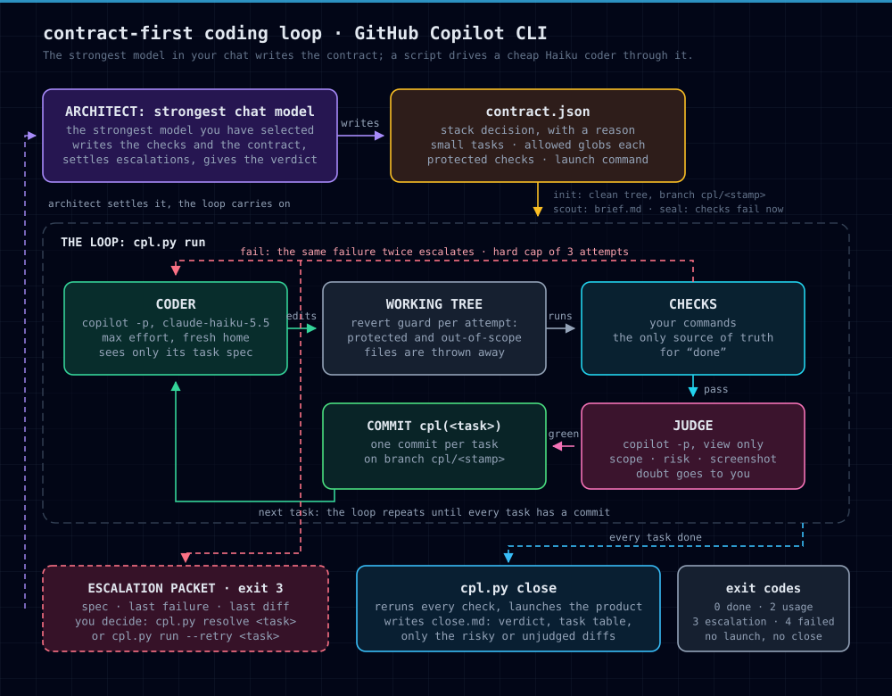

<div align="center">

# copilot-contract-loop

**Build software with a strong model's judgment at a cheap model's price, on GitHub Copilot CLI.**

[](#requirements) [](#requirements) [](LICENSE) [](skills/copilot-contract-loop/SKILL.md)

</div>

---



---

## The idea

Asking a cheap model to "build the feature" fails in a predictable way. It wanders outside the files it should touch, it declares victory without proof, and you spend more reading its output than you saved. Asking the strong model to do everything works, but the bill is high.

The loop splits the work by what each side does well. The architect, the strongest model you have selected in the current chat, writes the contract: the stack decision, small tasks, the files each task may touch, and the checks that prove each task done. A script then runs the loop with `copilot -p` on Haiku 5.5 at max effort. Executable checks decide "done", a judge gates what checks cannot see, and every run ends in a verdict.

Copilot CLI has no structured-output flag, so the judge answers in plain JSON that the script checks. Isolation comes from a fresh Copilot home for every call.

## When to use

- A coding task that splits into two or more small tasks, each with a command that proves it done.
- Not for one-line fixes, pure exploration, or work that no command can check.

## Roles

| Role | Default | Job | Tools |
|---|---|---|---|
| Architect | the strongest model selected in your current chat (`/model`) | writes the contract and the checks, settles escalations, gives the verdict | n/a |
| Scout | `copilot -p --model claude-haiku-5.5 --reasoning-effort max` | reads the repo, writes `brief.md` (asked to keep it to 60 lines) | view, grep, glob (read only) |
| Coder | `copilot -p --model claude-haiku-5.5 --reasoning-effort max` | implements one task at a time; sees only its spec | view, create, edit, grep, glob, bash |
| Judge | `copilot -p --model claude-haiku-5.5 --reasoning-effort max` | typed gates: scope, repeated failure, screenshot, risk per file | view only, with reads denied (the visual gate may read its image) |
| Checks | your commands | the only source of truth for "done" | n/a |

## How a run goes

1. **`init`** checks the CLI, refuses a dirty tree, cuts branch `cpl/<stamp>`, and creates the state directory outside the repo.
2. **`scout`** has Haiku 5.5 read the repo and write a one-page brief. The scout is read-only.
3. **Contract.** You write `contract.json` from the example: the stack decision with a reason, the tasks, the `allowed` globs, the `protected` checks, and the real `launch` command.
4. **`seal`** validates the contract and commits the checks.
5. **`run`** implements the tasks in order. After each attempt, out-of-scope and protected changes are reverted, the checks run, and the scope gate judges the diff. A passing task becomes a `cpl(<task>)` commit. A task that fails the same way twice, stays red after three attempts, or gets rejected by the scope gate goes to escalation (exit 3).
6. **`close`** reruns every check together, launches the product for real, and writes `close.md`: the verdict, a task table, and only the diffs judged high-risk or unjudged.
7. **Hand over.** The work sits on `cpl/<stamp>`. Nothing is merged or pushed unless you ask.

## Install

```sh
./install.sh                 # copies the skill to ${COPILOT_HOME:-~/.copilot}/skills/copilot-contract-loop
./install.sh --dir <path>    # any other skills root
```

Copilot CLI loads the installed copy, so after an edit to the repo, run `install.sh` again. Remove it with `rm -rf ~/.copilot/skills/copilot-contract-loop`.

## Commands

In Copilot CLI, ask for the contract loop and the skill takes over. To drive it yourself, define a shell function. A variable that holds a command with arguments breaks in zsh.

```sh
cpl() { python3 "$HOME/.copilot/skills/copilot-contract-loop/scripts/cpl.py" "$@"; }
cpl --repo <repo> init
cpl --repo <repo> scout --goal "..."
# write <state>/contract.json (start from <state>/contract.example.json), then:
cpl --repo <repo> seal
cpl --repo <repo> run
cpl --repo <repo> close
```

| Command | Does |
|---|---|
| `init [--force]` | CLI check, clean-tree check, branch `cpl/<stamp>`, state dir outside the repo |
| `scout --goal "..."` | Haiku 5.5 writes `brief.md` (asked to keep it to 60 lines), read-only |
| `seal` | Validates `contract.json`, commits the acceptance checks |
| `run [--no-judge]` | Implements tasks in order. Exit 3 = escalation packet waiting |
| `resolve <task>` | Accepts your own fix for an escalated task (checks must pass) |
| `run --retry <task>` | Discards the failed attempt and starts the task again |
| `close` | Reruns all checks, launches the product, writes `close.md`. Exit 4 = failed |
| `status` | One line per task, and the spend so far |

Exit codes: `0` done · `2` usage error · `3` escalation waiting for the architect · `4` failed (a missing CLI stops `init`; a login problem shows up as the error of the first call).

## What is enforced, and what is not

Enforced for every model call:
- a fresh Copilot home per call (`COPILOT_HOME`), so no settings, hooks, MCP servers, skills or saved approvals from your own Copilot setup reach the run. The target repo is untrusted in that home, so its repository hooks and workspace MCP servers do not run either;
- `--no-custom-instructions` (no AGENTS.md or copilot-instructions text) and `--disable-builtin-mcps` (no GitHub MCP tools);
- `--available-tools`: each role sees only the tools it names. An empty list would show every tool, so the loop refuses to build one;
- `--allow-tool` and `--deny-tool`. A deny rule wins over every allow: `.env` files, ssh, aws, gnupg, gh and netrc files; `curl`, `wget`, `ssh`, `scp`, `nc`, `sudo`, `gh`, `rm`, `cat`, `env` and `printenv`; and the git commands that commit, push, stash, checkout, switch, reset, merge or rebase;
- `--no-ask-user` and no `--allow-all`: anything that would need a prompt is denied, because a headless run cannot answer one;
- refused calls appear in the attempt's feedback and as `refused:` flags in the close report;
- an environment allowlist: `COPILOT_GITHUB_TOKEN`, `GH_TOKEN`, `GITHUB_TOKEN`, `COPILOT_ALLOW_ALL` and the other `COPILOT_*` switches are not passed on;
- the scope and protected-file guard reverts changes before and after the checks, so caches and build output stay out of the commit;
- each call's temporary home, which holds the session events, is deleted when the call ends. The logs keep only the final message, refusals, failures and spend.

Not enforced:
- Deny rules match command text. They are guardrails, not a sandbox: `python -c` or any other interpreter can reach files and the network that no rule names. For an untrusted repo, run the loop in a container.
- `shell(cat)` and `shell(rm)` block every use of those commands, not only the risky ones. Narrow them in `roles.json` if a task needs them.
- Auth is your Copilot login (`copilot login`, stored in the system keychain). The tool never reads a token from a file.
- The judge's probabilities are model estimates. Its JSON is checked for shape, not for truth. A malformed answer leaves the gate unjudged.

## Configuration

`skills/copilot-contract-loop/roles.json` holds the models, tool lists, allow and deny rules, the environment allowlist, spend caps and limits. Override it per machine with `~/.config/copilot-contract-loop/roles.json` or the `COPILOT_CONTRACT_LOOP_ROLES` variable. Models are any model ID that `copilot --model` accepts, for example `claude-haiku-5.5` or `gpt-5.4-nano`. Change a model there, not in the prompts. `effort` is passed as `--reasoning-effort`. It defaults to `max`; `high` or `medium` spend fewer reasoning tokens per call. Max effort uses more reasoning tokens, so check the spend in `status` on long runs.

The override merges one level down (for example `coder.model`), but a list replaces the default list. If you set `deny`, copy the rules you want to keep.

- `max_ai_credits` is passed to `--max-ai-credits`, a soft cap in AI credits. Copilot CLI refuses values below 30.
- `isolate_home: false` uses your own `~/.copilot` instead of a fresh home for each call. Use it only if your login is stored in `~/.copilot/config.json` because no system keychain is available. Your settings, hooks and MCP servers then apply to every run.
- A project whose checks need `curl`, or a variable from your shell, changes this file: remove the rule from `deny`, or add the name to `env_allow`.

## Environment

| Variable | Purpose |
|---|---|
| `COPILOT_CONTRACT_LOOP_ROLES` | path to a roles override |
| `COPILOT_CONTRACT_LOOP_STATE` | root for run state (default `$XDG_STATE_HOME/copilot-contract-loop`, else `~/.local/state/copilot-contract-loop`) |
| `COPILOT_CONTRACT_LOOP_CLI` | command that starts Copilot CLI (default `copilot`); the tests point it at a fake |

The model processes get a short allowlist: `PATH`, `HOME`, locale and temp variables, and the names in `env_allow`. A token such as `GH_TOKEN` is not passed on, so the login is the only credential. To pass a variable a check needs, such as a proxy setting, add its name to `env_allow`.

## State layout

Everything lives outside the repo, so a failed run never pollutes your worktree:

```
<state root>/<repo>-<hash>/
├── state.json                task states, spend, flags
├── contract.json             your contract (the example is copied here on init)
├── contract.example.json
├── brief.md                  the scout's brief
├── escalations/<task>.md     packet: spec, last failure, last diff
├── refs/<task>/              reference image given to the coder, if any
├── shots/<task>.png          screenshot for the visual gate
├── judge/<task>/             images the visual judge reads
├── scratch/                  a call's temporary home lives here only while the call runs
├── log/                      prompts, condensed call summaries (exit, spend, refusals, final message), check output
└── close.md                  the final report
```

## Requirements

- GitHub Copilot CLI, logged in with `copilot login`. Written against Copilot CLI 1.0.114.
- Each model call uses premium requests. On the account used for testing, `claude-haiku-5.5` costs 1 premium request per call (checked live), and `claude-haiku-4.5` cost 0.33. Max effort can add reasoning tokens on top of that.
- Access to `claude-haiku-5.5` on your account. If it is not available, the first call fails and names the model; change `model` in `roles.json`.
- Python 3.9+ and git. `cpl.py` uses the standard library only.
- Optional, for the visual gate: Chrome or Chromium, used headless for screenshots.

## Tests

```sh
python3 -m unittest discover -s tests -v
```

28 tests, fully offline. A fake `copilot` CLI stands in for the models. It writes the same JSONL events the real CLI writes with `--output-format json`, so the suite covers the parsing of refusals, failures, final messages and exit codes. CI runs it on Python 3.9 and 3.13.

## What has been run against the real CLI

- Flags and event shapes were checked against Copilot CLI 1.0.114: a refused call, a file write, the JSON result and the usage file.
- A full `init`, `seal`, `run` and `close` ran on a scratch repository with `claude-haiku-4.5`, before the default moved to 5.5. The coder finished in one attempt, the scope gate accepted the diff (p=1.00), the checks and the launch passed, and the commit held only the file the task allowed.
- The default configuration (`claude-haiku-5.5` at max effort) was checked with one live call: it returned OK and cost one premium request.
- Not yet run live: the visual gate, escalation against a real model, and a login that lives only in `~/.copilot/config.json`.

## Design notes

- **Contract first.** The checks are written before the implementation exists, by the model best placed to judge them. That is what makes a cheap coder safe to use.
- **Isolation by home.** Copilot CLI keeps settings, hooks, MCP servers, skills and saved approvals under `COPILOT_HOME`. Giving each call a fresh one is the strongest lever the CLI offers, and the login still works because the token lives in the keychain.
- **Non-interactive by design.** `--no-ask-user` and no allow-all mean that anything not pre-approved is refused, so a headless run cannot stall on a question.
- **Judge answers are checked.** Copilot CLI has no structured output flag. The judge is asked for one JSON object, the script checks its shape against the questions, and a bad answer leaves the gate unjudged.
- **Empty tool lists are refused.** `--available-tools=` with nothing after the equals sign shows every tool, so the script never builds that call.
- **State outside the repo.** `init` refuses a dirty tree, because an acceptance check written beforehand would count as dirt.
- **Globs use `fnmatch`**, where `*` also crosses `/`. Write `tests/**` for a whole tree.
- **Own runtime names.** The paths, variables and branch prefix (`copilot-contract-loop`, `COPILOT_CONTRACT_LOOP_*`, `cpl/`) belong to this tool alone, so its state never mixes with another install.
- **Private code** goes to the model providers behind GitHub Copilot, through your account.

## Notes on GitHub Copilot CLI

- Models run through `copilot -p`, with `claude-haiku-5.5` at max effort as the default. Any model ID that `copilot --model` accepts works in `roles.json`.
- Isolation uses a fresh `COPILOT_HOME` per call. No settings, hooks, MCP servers, skills or saved approvals from your own Copilot setup reach a run.
- Tool permissions use `--available-tools`, `--allow-tool` and `--deny-tool`. Copilot CLI shows a model only the tools it names, and a deny rule wins over every allow.
- The judge has no `--json-schema`. Its answer is parsed from text and checked against the questions.
- Spend is reported in premium requests and AI credits, not USD. `--max-ai-credits` is a soft cap, and Copilot CLI refuses values below 30.
- This loop sets no turn cap for Copilot runs. Each call is bounded by `budget_s`, a wall-clock limit.
- Session transcripts are not kept by this tool: the temporary home that holds the session events is deleted when each call ends.
- No mockup generation in this loop. Put your own PNG in a task's `reference`. The coder reads it, and the visual gate compares the screenshot against it.

## License
MIT. See [LICENSE](LICENSE).
